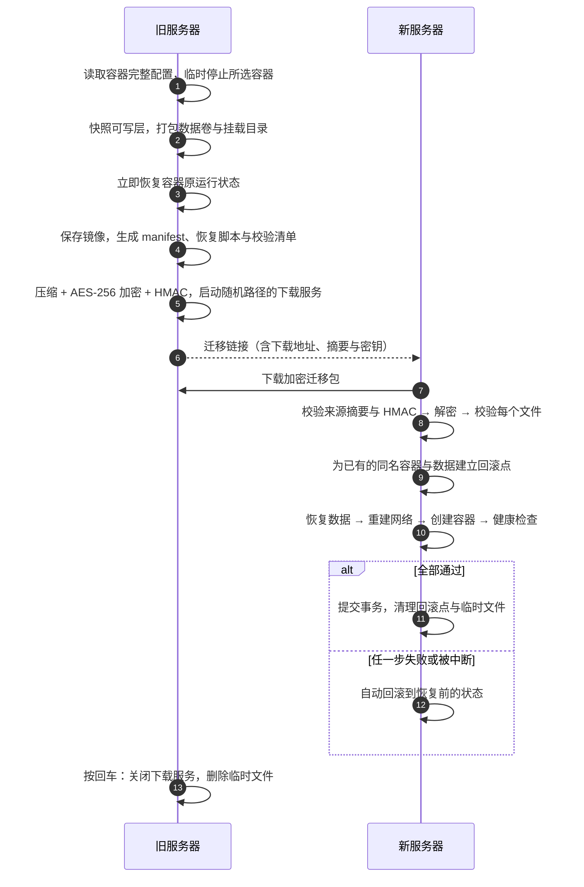

<div align="center">

# 🐳 Docker Migrate

**把 Docker 容器原样搬到另一台服务器，只需要复制一条链接。**

镜像、数据卷、挂载目录、端口、环境变量、网络、Compose 配置，连容器里没挂载出来的改动也一起迁移；
全程加密传输、完整性校验，恢复失败自动回滚。

[](https://github.com/lx969788249/docker_migrate/actions/workflows/ci.yml)
[](https://github.com/lx969788249/docker_migrate/stargazers)
[](https://github.com/lx969788249/docker_migrate/commits/master)


[快速开始](#-快速开始) · [功能特性](#-功能特性) · [迁移范围](#-迁移范围) · [工作原理](#-工作原理) · [高级用法](#-高级用法) · [常见问题](#-常见问题)

</div>

---

## ✨ 为什么需要它

换服务器时最怕的不是“怎么搬”，而是“搬漏了什么”：

- 当初 `docker run` 的端口、环境变量、重启策略、资源限制还记得吗？
- 数据卷和宿主机挂载目录有没有漏掉？权限和属主对不对？
- 进容器里改过的配置文件，没挂载出来，还能带走吗？
- 搬到一半失败了，新服务器会不会变成半成品？

Docker Migrate 直接读取容器的完整运行配置，把它和所有数据打成一个加密迁移包。新服务器粘贴链接后，脚本按原配置重建容器，并逐项验证；任何一步失败都会自动回滚，不会留下半成品。

## 🚀 快速开始

在**旧服务器**和**新服务器**上运行同一条命令：

```bash
bash <(curl -fsSL https://raw.githubusercontent.com/lx969788249/docker_migrate/master/docker_migrate_perfect.sh)
```

| 步骤 | 在哪里 | 做什么 |
|:---:|---|---|
| 1 | 旧服务器 | 选择 `1) 备份容器并传输`，勾选要迁移的容器（Compose 项目按组显示） |
| 2 | 旧服务器 | 复制脚本输出的迁移链接 |
| 3 | 新服务器 | 选择 `2) 下载备份并恢复`，粘贴链接 |
| 4 | 旧服务器 | 新服务器显示恢复成功后按回车，脚本关闭下载服务并清理临时文件 |

> [!WARNING]
> 迁移链接中包含本次迁移包的解密密钥。请完整复制，并只通过可信渠道发送，不要公开。

> [!TIP]
> 新服务器下载失败时，最常见的原因是旧服务器的防火墙或云厂商安全组没有放行下载端口。脚本会在链接下方提示需要放行的端口。

## 📺 运行效果

整个过程分成几个步骤，每步只占一行；耗时较长的步骤会实时显示进度、速度和剩余时间。

旧服务器：

```text
[1/7] 检查环境 ✓ Docker 27.3.1 · 2 秒
[2/7] 选择容器 ✓ 5 个容器 · 6 秒
[3/7] 读取配置 ✓ 5 个容器 · 1 秒
[4/7] 停机并打包数据 ✓ 3 个卷 · 2 个目录 · 1.8GB · 停机 42 秒 · 44 秒
[5/7] 保存镜像 ██████████████░░░░░░ 72% · 1.5GB/2.1GB · 45MB/s · 剩余约 13 秒
```

迁移包就绪后，会给出迁移链接：

```text
━━━━━━━━━━ 迁移包已就绪 ━━━━━━━━━━
下载链接（请完整复制）：
http://127.0.0.1:8080/Xk3fQ9.../docker_migrate_20261019-101500_a1B2c3D4e5.tar.gz.enc#sha256=…&enc=aes-256-ctr-hmac-sha256-v1&secret=…&iv=…&mac=…

使用方法：在新服务器运行同一脚本 → 选择「2) 下载备份并恢复」→ 粘贴上面的完整链接。
新服务器下载失败时，请确认旧服务器防火墙和云厂商安全组已放行 TCP 8080 端口。
目标端恢复成功后，回到此窗口按回车停止传输服务并清理临时文件。
━━━━━━━━━━━━━━━━━━━━━━━━━━━━━━━━━━━━━━
```

新服务器恢复完成后：

```text
[1/8] 检查环境 ✓ Docker 27.3.1 · 1 秒
[2/8] 下载迁移包 ✓ 2.3GB · 52 秒
[3/8] 校验并解密 ✓ 2.3GB · 38 秒
[4/8] 预检数据 ✓ 3 个卷 · 2 个目录 · 4 秒
[5/8] 加载镜像 ✓ 2.1GB · 41 秒
[6/8] 建立回滚点 ✓ 2 秒
[7/8] 恢复数据 ✓ 9 秒
[8/8] 启动服务 ✓ 3 个容器 · 1 个 Compose 项目 · 17 秒

━━━━━━━━━━ Docker 迁移结果 ━━━━━━━━━━
结果：✅ 恢复成功
容器：5 个（运行 4 / 暂停 0 / 停止 1）
数据：3 个 volume、2 个 bind 目录
验证：完整性校验、服务启动与健康检查均已通过
阶段耗时：检查环境 1 秒 · 下载迁移包 52 秒 · 校验并解密 38 秒 · …
清理：下载文件与临时目录已删除
耗时：2 分 44 秒
━━━━━━━━━━━━━━━━━━━━━━━━━━━━━━━━━━━━━━
```

出错时，结果中会给出失败的步骤、原因、建议和日志位置：

```text
[8/8] 启动服务 ✗
━━━━━━━━━━ Docker 迁移结果 ━━━━━━━━━━
结果：❌ 恢复失败，已安全回滚
失败阶段：恢复独立容器
目标端状态：旧服务与原数据已恢复
原因：容器 nginx 创建失败：宿主机端口 80 已被其他程序占用
建议：执行 ss -lntp | grep ":80 " 查看占用的进程，停止它或修改端口后重试
日志：/root/docker_migrate_logs/restore-20261019-102233-4182.log
      反馈问题时请附上这个文件（密钥与密码已自动隐藏），或运行 --diagnose 生成诊断包。
━━━━━━━━━━━━━━━━━━━━━━━━━━━━━━━━━━━━━━
```

## 🧩 功能特性

<table>
<tr>
<td width="50%" valign="top">

### 📦 完整迁移
- 按原配置重建容器：端口、环境变量、启动命令、重启策略、资源限制、健康检查、能力、ulimit、tmpfs、DNS 等
- 命名卷与宿主机挂载目录连同权限和属主一起迁移
- 容器内**未挂载出来的改动**通过可写层快照迁移
- Docker Compose 项目整组迁移，保留多文件配置与 `env_file`
- 自定义网络连同子网、网关、静态 IP、别名一起重建
- 运行、暂停、停止状态原样保留

</td>
<td width="50%" valign="top">

### 🔒 安全传输
- 迁移包使用 AES-256 加密，并以 HMAC-SHA256 认证，密钥只存在于链接里
- 下载地址带随机路径，服务器上不会留下明文迁移包
- 解密前校验来源摘要与 HMAC，解压后逐个校验文件的 SHA-256，拒绝被篡改的包
- 解压前检查归档结构，阻止路径穿越与链接越界写入

</td>
</tr>
<tr>
<td width="50%" valign="top">

### 🛡️ 失败可回滚
- 恢复以**事务**方式进行：新服务器上已有的同名容器、数据卷、目录和 Compose 配置先建立回滚点
- 任何一步失败（端口冲突、健康检查不通过、被 Ctrl+C 中断），都会自动还原到恢复前的状态
- 旧服务器：备份时临时停机，数据快照完成后立即恢复原状态，出错或中断也会恢复

</td>
<td width="50%" valign="top">

### 🧠 省心
- 一条命令完成依赖安装、选择容器、打包、传输、恢复与清理
- 自动识别并跳过 `/etc/localtime`、`/proc`、`/sys` 等宿主机系统路径，不会覆盖新服务器的系统文件
- 共享网络命名空间的容器（如 VPN sidecar）自动按依赖顺序恢复
- 提前检查磁盘空间，进度、耗时与失败原因一目了然
- 支持 IPv4 / IPv6，支持交互与非交互两种方式

</td>
</tr>
</table>

## 📋 迁移范围

| 内容 | 是否迁移 | 说明 |
|---|:---:|---|
| 镜像 | ✅ | 随迁移包传输，新服务器无需联网拉取 |
| 命名卷（volume） | ✅ | 包括 driver 与 options |
| 宿主机挂载目录 / 文件（bind） | ✅ | 恢复到原路径；软链接会在原路径重建 |
| 容器内未挂载的改动 | ✅ | 仅在容器确有改动时创建快照镜像，否则沿用原镜像名 |
| 端口、环境变量、命令、重启策略、资源限制、健康检查等 | ✅ | 详见[功能特性](#-功能特性) |
| 自定义网络、静态 IP、网络别名 | ✅ | 动态分配的 IP 不会被固定 |
| Docker Compose 配置 | ✅ | 恢复到原工作目录 |
| 运行 / 暂停 / 停止状态 | ✅ | |
| `/etc/localtime`、`/proc`、`/sys`、`/dev` 等系统路径 | ↪️ | 只在新服务器重建挂载关系，不覆盖新服务器的系统文件 |
| Docker socket（`/var/run/docker.sock`） | ↪️ | 同上，挂载关系保留，指向新服务器自己的 Docker |
| 不同 CPU 架构之间迁移（如 ARM → x86） | ❌ | 镜像与架构绑定，请在同架构的服务器之间迁移 |
| 运行中进程的内存状态 | ❌ | 容器会在新服务器上重新启动 |

## 🔍 工作原理



## 🆚 与常见做法对比

| | 手动 `docker save` + `scp` | 由容器反推 `docker run` 的工具 | 数据卷备份工具 | **Docker Migrate** |
|---|:---:|:---:|:---:|:---:|
| 镜像 | ✅ | ❌ | ❌ | ✅ |
| 运行参数（端口、环境变量等） | 手动记录 | ✅ | ❌ | ✅ |
| 数据卷与挂载目录 | 手动打包 | ❌ | ✅ | ✅ |
| 容器内未挂载的改动 | ❌ | ❌ | ❌ | ✅ |
| Compose 项目、自定义网络 | 手动 | 部分 | ❌ | ✅ |
| 加密传输与完整性校验 | ❌ | ❌ | 部分 | ✅ |
| 失败自动回滚 | ❌ | ❌ | ❌ | ✅ |
| 操作步骤 | 多步手工 | 多步手工 | 多步手工 | **复制一条链接** |

## 🔧 高级用法

### 命令行参数

```bash
# 只迁移指定容器，跳过交互式菜单
bash docker_migrate_perfect.sh --backup --include=nginx,mysql

# 不停机备份（数据库等有状态服务可能不一致，谨慎使用）
bash docker_migrate_perfect.sh --backup --no-stop

# 在新服务器直接恢复
bash docker_migrate_perfect.sh --restore='http://…完整链接…'

# 在屏幕上显示每一步的细节（默认只写进日志）
bash docker_migrate_perfect.sh --verbose

# 出问题时收集诊断信息，生成一个可以附到 issue 里的文件
bash docker_migrate_perfect.sh --diagnose
```

在非交互环境（定时任务、`nohup`）中运行备份时，下载服务会保持运行，并提示一条 `kill -TERM <pid>` 命令，恢复完成后用它结束源端任务。

### 环境变量

| 变量 | 默认值 | 说明 |
|---|---|---|
| `PORT` | `8080` | 下载服务端口，被占用时自动向后寻找 |
| `ADVERTISE_HOST` | 自动探测 | 链接中使用的公网 IP 或域名（NAT、多网卡或探测不准时设置） |
| `DOCKER_MIGRATE_SNAPSHOT` | `auto` | 可写层快照：`auto` 有改动才快照，`always` 总是快照，`never` 不迁移容器内未挂载的改动 |
| `STOP_SHARED_MOUNTS` | — | 设为 `1` 时，非交互模式下允许临时停止与所选容器共享数据的其他容器 |
| `RESTORE_EXISTING` | `replace` | 新服务器已有同名容器时：`replace` 替换（可回滚）、`skip` 跳过、`fail` 中止 |
| `RESTORE_BASE` | `~/docker_migrate_restore` | 新服务器下载与解压的工作目录 |
| `RESTORE_KEEP` | — | 设为 `1` 时，恢复成功后保留下载与解压文件 |
| `RESTORE_CLEAN_ALL` | — | 设为 `1` 时，恢复失败也删除下载文件（默认保留以便排查） |
| `RESTORE_HEALTH_TIMEOUT` | `60` | 恢复后等待健康检查通过的秒数 |
| `DOCKER_MIGRATE_LOG_DIR` | `~/docker_migrate_logs` | 运行日志目录。成功后日志自动删除，失败时保留并在结果中给出路径 |
| `DOCKER_MIGRATE_KEEP_LOG` | — | 设为 `1` 时，成功后也保留日志 |

完整说明见 `bash docker_migrate_perfect.sh --help`。

## 💻 系统要求

- Linux 服务器（Debian / Ubuntu / CentOS / Rocky / Fedora / openSUSE / Alpine 等），root 或可使用 sudo 的用户
- 已安装 Docker；Compose 项目需要 `docker compose` 或 `docker-compose`
- bash 4.0 及以上
- 其余依赖（`curl`、`jq`、`python3`、`openssl`、`tar` 等）会通过 apt / dnf / yum / zypper / apk 自动安装
- 源服务器对新服务器开放一个 TCP 端口（默认 8080）

## ❓ 常见问题

<details>
<summary><b>新服务器下载失败 / 连接超时</b></summary>

1. 确认旧服务器的防火墙放行了下载端口，例如 `ufw allow 8080/tcp` 或 `firewall-cmd --add-port=8080/tcp`。
2. 确认云厂商控制台的安全组也放行了该端口。
3. 如果链接中的 IP 不对（NAT、内网或多网卡），用 `ADVERTISE_HOST=你的公网IP` 重新运行备份。

</details>

<details>
<summary><b>迁移会让旧服务器停机多久？</b></summary>

只在打包容器数据期间停机（快照可写层、打包数据卷与挂载目录）。数据快照完成后容器会立即恢复运行，后续的镜像保存、加密和传输都不影响旧服务器上的服务。
</details>

<details>
<summary><b>恢复失败了怎么办？新服务器会不会被搞乱？</b></summary>

不会。恢复以事务方式进行，失败或按 Ctrl+C 中断时会自动回滚：本次新建的容器被删除，被替换的同名容器、数据卷、挂载目录和 Compose 配置还原到恢复前的状态。结果摘要会给出失败阶段和诊断目录，修正问题（如端口冲突）后重新粘贴链接即可。
</details>

<details>
<summary><b>为什么恢复后有的容器镜像名变成了 <code>docker-migrate-snapshot:…</code>？</b></summary>

这些容器在运行期间改动过容器内未挂载的文件，为了不丢失这些改动，脚本为它们创建了快照镜像。没有改动的容器会沿用原镜像名，可以正常 `docker pull` 升级。以后想升级快照容器，请用原镜像重新创建；如果不需要保留这些改动，可以设置 `DOCKER_MIGRATE_SNAPSHOT=never`。
</details>

<details>
<summary><b>新服务器上已经有同名容器怎么办？</b></summary>

默认（`RESTORE_EXISTING=replace`）会用迁移的配置替换它，替换前建立回滚点，失败时原容器会被还原。也可以设为 `skip` 保留已有容器，或设为 `fail` 直接中止。
</details>

<details>
<summary><b>需要多少磁盘空间？</b></summary>

旧服务器大约需要“镜像 + 数据”的两倍空间（打包文件和加密文件）；新服务器大约需要迁移包大小的 2~3 倍（下载文件、解密文件和解压目录）。脚本会在加密和解密前检查剩余空间，用完的中间文件会尽早删除。
</details>

<details>
<summary><b>出错了怎么反馈？</b></summary>

每次运行都会把完整过程写进日志（`~/docker_migrate_logs/`）。成功后日志自动删除；失败时结果里会给出日志路径，提交 [Issue](https://github.com/lx969788249/docker_migrate/issues) 时附上它即可。也可以运行 `bash docker_migrate_perfect.sh --diagnose` 生成一份包含系统、Docker 状态和最近日志的诊断文件。日志和诊断文件中的迁移密钥、容器密码等敏感信息会自动替换为 `***`。
</details>

<details>
<summary><b>链接泄露了会怎样？</b></summary>

拿到完整链接的人可以在下载服务开启期间下载并解密迁移包。迁移完成后在旧服务器按回车关闭下载服务，链接就会失效。只拿到下载地址、没有 `#` 后面密钥部分的人，下载到的只是无法解密的密文。
</details>

## 🛠️ 参与开发

源码按功能拆分在 [`src/`](src) 目录，发布用的 `docker_migrate_perfect.sh` 由 `./build.sh` 合并生成，请不要直接修改它。

```bash
./build.sh         # 修改 src/ 后重新生成发布脚本
tests/run.sh       # 运行单元测试（需要 bash 4+、jq、python3、openssl）
```

| 目录 | 内容 |
|---|---|
| `src/lib/` | 主脚本与生成的恢复脚本共用的函数（进度、路径判断、校验、加密、容器网络等） |
| `src/backup/` | 源端数据采集、打包与 HTTP 下载服务；`src/backup/flow/` 是备份主流程 |
| `src/restore/` | 新服务器下载、校验与解密 |
| `src/templates/` | 写入迁移包的 `restore.sh` 与单容器恢复脚本，通过 `# @include` 复用 `src/lib/` |
| `tests/` | 单元测试、Docker 集成测试、真实配置保真度测试与端到端迁移测试 |
| `docs/` | [两台服务器的手动验收清单](docs/manual-vps-test.md) |

每次提交都会在 CI 中运行 ShellCheck、格式检查、单元测试、Docker 集成测试与端到端迁移测试，并在 bash 4.0 / 4.2 / 4.4、Alpine、Debian、Rocky Linux 上验证兼容性。

## 💬 反馈

- 遇到问题请提交 [Issue](https://github.com/lx969788249/docker_migrate/issues)，附上脚本失败时给出的日志文件，或运行 `--diagnose` 生成的诊断文件（密钥与密码已自动隐藏）。
- 版本变化见 [CHANGELOG](CHANGELOG.md)。

如果这个项目帮你省下了一次搬家的时间，欢迎点一个 ⭐ Star。

## 📈 Star History

[](https://star-history.com/#lx969788249/docker_migrate&Date)
